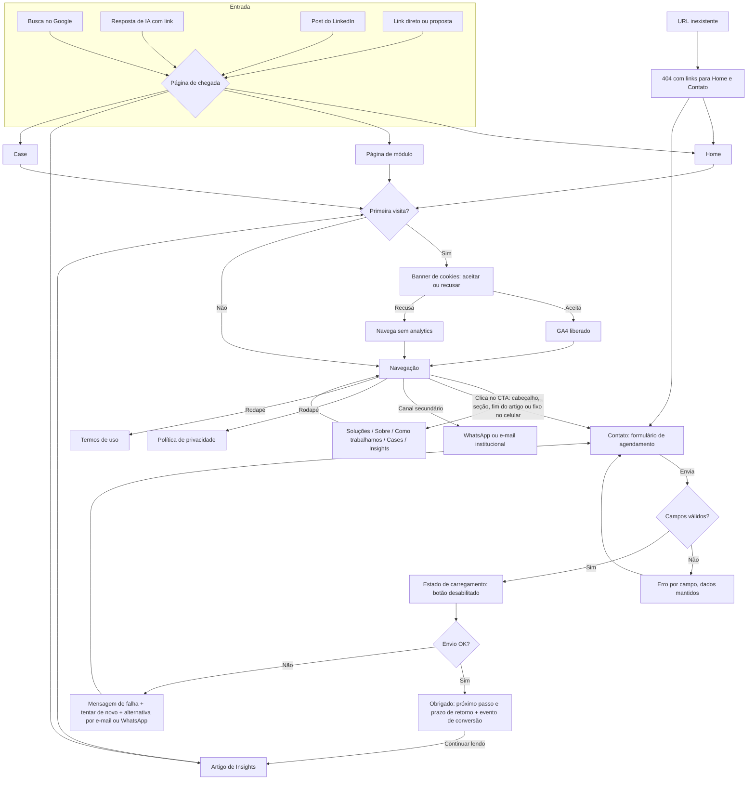

# App Flow — Black River Consultoria

> Gerado a partir do BRIEF.md (aprovado em 13/10/2026). Toda página ou estado exigido pelo checklist de produção (404, carregando, erro, obrigado, cookies, páginas legais) aparece aqui.
> Pacote: institucional + conteúdo. CTA único em todas as páginas: **Agendar conversa de diagnóstico** (1 hora, sem custo, online ou presencial).

## Páginas

| Rota | Página | Palavra-chave principal *(proposta)* | Papel |
| --- | --- | --- | --- |
| `/` | Home | consultoria em logística para varejo e atacado | Proposta de valor, dor → jornada → transformação, provas, CTA |
| `/sobre` | Sobre | Black River Consultoria · Luis Ricardo Pedro | História, 30+ cases em 15 anos, currículo verificável do Luis (lacuna A) |
| `/solucoes` | Soluções (visão geral) | consultoria em logística e supply chain | Os 7 módulos e como se combinam |
| `/solucoes/diagnostico-logistico` | Módulo 1 | diagnóstico logístico | Porta de entrada de todo projeto |
| `/solucoes/projeto-de-centro-de-distribuicao` | Módulo 2 | projeto de centro de distribuição | |
| `/solucoes/eficiencia-operacional-em-centro-de-distribuicao` | Módulo 3 | eficiência operacional em centro de distribuição | |
| `/solucoes/gestao-de-abastecimento-e-estoques` | Módulo 4 | gestão de abastecimento e estoques no varejo | |
| `/solucoes/negociacao-de-verbas-logisticas` | Módulo 5 | verbas logísticas com fornecedores | Lacuna B: território sem concorrente |
| `/solucoes/tecnologia-aplicada-a-supply-chain` | Módulo 6 | tecnologia para supply chain (WMS) | |
| `/solucoes/transporte-e-malha-logistica` | Módulo 7 | malha logística | |
| `/como-trabalhamos` | Como trabalhamos | como funciona uma consultoria de logística | Diagnóstico validado → cronograma e entregas → execução conjunta (lacunas C e D); prazos típicos quando confirmados |
| `/cases` | Cases (lista) | cases de logística no varejo | Cases anonimizados + faixa de logos autorizados (sem ligar logo a case) |
| `/cases/[slug]` | Case | [tema do case] | Contexto → desafio → solução → resultado ("meta traçada", nunca ganho inventado) |
| `/insights` | Insights (lista) | artigos sobre logística no varejo | Conteúdo para busca e IAs; filtros por módulo |
| `/insights/[slug]` | Artigo | [pergunta respondida] | Abre com a resposta na 1ª frase (AEO); autoria do Luis; CTA no fim |
| `/contato` | Contato | agendar diagnóstico logístico | Formulário do CTA + e-mail e WhatsApp institucionais (secundários) |
| `/obrigado` | Obrigado | — | Confirma o envio, diz o próximo passo e o prazo de retorno; evento de conversão |
| `/privacidade` | Política de privacidade | — | LGPD: dados coletados, finalidade, retenção, encarregado |
| `/termos` | Termos de uso | — | |
| (rota inexistente) | 404 | — | Visual do site, volta à Home e ao CTA |

Elementos presentes em todas as páginas: cabeçalho com logo "Horizontal — Site" e botão do CTA · rodapé com módulos, contato, LinkedIn, privacidade e termos · **CTA fixo no celular** · banner de cookies na primeira visita.

Arquivos técnicos (Etapa 7): `/sitemap.xml`, `/robots.txt` (política: liberar busca e treino), `/llms.txt`, JSON-LD Organization/ProfessionalService em todas as páginas, Service nas páginas de módulo, Article nos artigos, FAQPage onde houver FAQ, BreadcrumbList nas internas.

## Fluxo principal

## Formulário de agendamento (detalhe para o SCHEMA)

*(proposta: mínimo necessário para qualificar a conversa)*

- Obrigatórios: nome · e-mail corporativo · empresa · cargo · consentimento LGPD
- Opcionais: telefone/WhatsApp · preferência (online / presencial) · módulo de interesse (lista dos 7 + "ainda não sei") · mensagem curta
- Proteção: honeypot ou Turnstile + limite de envios
- Origem registrada: página de onde veio o clique (para saber se Insights, módulos ou LinkedIn geram conversas)

## Caminhos sem saída verificados

- Artigo de Insights: termina com CTA e links para o módulo relacionado e 2 artigos (sem beco).
- Case: termina com CTA e link para o módulo usado.
- Obrigado: oferece Insights, para não terminar em página vazia.
- 404: leva à Home e ao Contato.
- Falha de envio: oferece e-mail e WhatsApp como saída, além de tentar de novo.

## Decisões e pontos em aberto

- Prazo de retorno informado no Obrigado: **em até 1 dia útil** (aprovado 13/10/2026).
- Lançamento: **4 cases já aprovados (WMS, cross docking, estrutura do Centro de Distribuição, separação) + 3 artigos, um por lacuna** (aprovado 13/10/2026).
- Palavras-chave da tabela acima: propostas, a validar na escrita de cada página.
