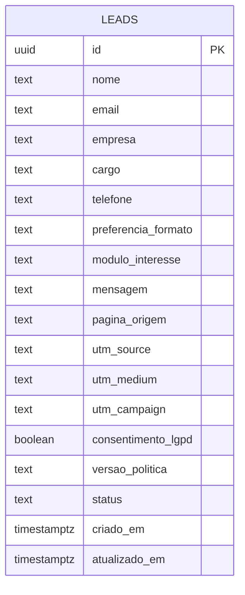

# SCHEMA.md — Black River Consultoria

> Derivado do APP_FLOW.md (aprovado em 13/10/2026). O único ponto em que o site recebe dados pessoais é o **formulário de agendamento** (`/contato`). Não há login, área de cliente, upload nem comentários.
> Este arquivo descreve a estrutura de dados da Black River: tratar como confidencial.

## Arquitetura do envio (aprovada em 13/10/2026: Supabase + e-mail)

```
Navegador (/contato, página estática)
  └─ POST → Função da Cloudflare (/api/agendamento)
        1. Confere Turnstile (antirrobô) e honeypot
        2. Limite de envios por IP (regra de rate limit da Cloudflare)
        3. Valida todos os campos no servidor (Zod)
        4. Em paralelo, independentes um do outro (ajuste de 14/10/2026):
           a. grava em Supabase com a chave de serviço (só no servidor)
           b. envia o e-mail de aviso ao e-mail institucional (Resend), com todos os campos
        5. Se pelo menos um dos dois deu certo → responde OK → /obrigado e evento no GA4
           (e-mail ao visitante só depois disso). Se o banco falhou, o aviso sai marcado
           "não gravado no banco" e a falha fica no log da Cloudflare.
        6. Se os dois falharam → erro ao visitante, com "tentar de novo" e os contatos diretos
```

**Por que gravar e avisar em paralelo (decisão do João, 14/10/2026):** no plano Free o projeto do Supabase pode pausar. Com o e-mail independente do banco, nenhum pedido se perde enquanto o banco estiver fora do ar.

Por que assim: o site continua 100% estático (mais rápido e barato na Cloudflare), e o navegador **nunca** fala direto com o banco. Diferente do modelo do kit (inserção anônima com RLS), aqui a tabela não tem nenhuma política para visitantes: só a função, com a chave de serviço, grava.

## Plano Free: pausa e backup (decisão do João, 14/10/2026)

O projeto usa o plano **Free** do Supabase, na região **São Paulo** (sa-east-1). O volume do formulário (dezenas de pedidos por mês) cabe com folga nos 500 MB do plano. Ele tem duas limitações, tratadas assim:

| Limitação do Free | Tratamento |
| --- | --- |
| Pausa após 7 dias de pouca atividade (o formulário pode passar uma semana sem pedidos) | **Sinal diário:** o Worker `workers/manter-ativo` (Cloudflare, tarefa agendada) chama `public.ping()` todo dia com a chave anônima. E a função do formulário avisa por e-mail mesmo com o banco fora do ar (Arquitetura, passo 4). |
| Sem backup automático | **Exportação mensal obrigatória** da tabela `leads` (painel › Table Editor › Export CSV), guardada em pasta de acesso restrito da Black River e apagada junto com a retenção de 12 meses. Item fixo do plano de manutenção. |

Configuração do projeto, na criação: Data API ligado; "Automatically expose new tables" **desligado** (cada acesso é liberado no script); "Enable automatic RLS" **ligado**; Postgres padrão (sem OrioleDB).

Passar para o Pro (US$ 25/mês: nunca pausa, backup diário por 7 dias) quando o formulário virar canal comercial relevante.

## Entidades

| Entidade | Campos | Regras de acesso | Integrações | Retenção (LGPD) |
| --- | --- | --- | --- | --- |
| `leads` | nome, email, empresa, cargo, telefone, preferencia_formato, modulo_interesse, mensagem, pagina_origem, utm_source, utm_medium, utm_campaign, consentimento_lgpd, versao_politica, status, criado_em, atualizado_em | RLS ativo, **nenhuma política** para `anon`/`authenticated`. Escrita só pela Função da Cloudflare (service role). Leitura só pelo painel do Supabase (João e quem ele autorizar). | E-mail de aviso (Resend) · CRM [A CONFIRMAR] | 12 meses sem relação comercial → exclusão automática (rotina semanal no pg_cron). Com proposta ou contrato, o contato passa para o controle comercial e sai desta tabela. |

### Campos

| Campo | Tipo | Obrigatório | Origem | Por que existe |
| --- | --- | --- | --- | --- |
| `nome` | texto (2–120) | sim | formulário | Contato |
| `email` | texto, formato e-mail | sim | formulário | Contato; e-mail corporativo pedido no rótulo, sem bloquear domínios gratuitos |
| `empresa` | texto (2–160) | sim | formulário | Qualificação |
| `cargo` | texto (2–120) | sim | formulário | Qualificação (público é C-level e diretoria) |
| `telefone` | texto (até 20, só dígitos) | sim no formulário (decisão do João, 14/10/2026); a coluna aceita vazio | formulário | Retorno por WhatsApp/telefone |
| `preferencia_formato` | `online` · `presencial` · `tanto_faz` | não | **fora do formulário** (decisão de 14/10/2026: nenhum campo opcional visível; o formato é combinado no retorno) | Coluna reservada |
| `modulo_interesse` | uma das 7 frentes ou `nao_sei` | não | automático: vem escondido do link `?modulo=` quando a pessoa chega por uma página de frente (código desconhecido é ignorado) | Preparar a conversa |
| `mensagem` | texto (até 1.000) | não | **fora do formulário** (decisão de 14/10/2026) | Coluna reservada |
| `pagina_origem` | texto (até 300) | automático | última página do site antes do formulário; se a pessoa chegou direto, o site de onde veio | Saber se frentes, Insights ou cases geram conversas |
| `utm_source/medium/campaign` | texto (até 120) | automático | URL da chegada ao site, guardada só na aba do navegador até o envio | Medir LinkedIn e e-mail (não é dado pessoal) |
| `consentimento_lgpd` | booleano | sim (`true`) | caixa de seleção, **desmarcada por padrão** | Base legal |
| `versao_politica` | texto (ex.: `2026-10`) | automático | constante no código | Prova de qual política foi aceita |
| `status` | `novo` · `contatado` · `agendado` · `realizado` · `descartado` | automático (`novo`); atualizado no painel | — | **Medir a meta de 90 dias** (conversas agendadas e realizadas) |
| `criado_em` / `atualizado_em` | data e hora | automático | banco | Prazo de retorno de 1 dia útil e retenção |

Não coletamos: CPF, endereço, faturamento da empresa, IP gravado em tabela (o rate limit usa o IP só na Cloudflare, sem armazenar).

## Diagrama



## SQL (Supabase)

O script fica em [`supabase/migrations/20261014000000_leads.sql`](../supabase/migrations/20261014000000_leads.sql) e foi testado num Postgres local em 14/10/2026: gravação pela service role, bloqueio de leitura e gravação pelas chaves públicas, regras de cada campo, gatilho de `atualizado_em` e retenção. Em relação ao rascunho aprovado em 13/10/2026, ele acrescenta:

- **Acessos explícitos:** `revoke` para `anon`/`authenticated` e `grant` só para `service_role`, porque o projeto não expõe tabelas novas automaticamente.
- **`search_path` fixo** na função do gatilho (o Security Advisor do Supabase alerta sem isso).
- **Limites de tamanho** em `pagina_origem` e nas UTMs (até 300 e 120 caracteres).
- **`public.ping()`**, que só devolve 1, para o sinal diário do plano Free.
- Retenção às segundas às 6h UTC (3h em Brasília).

Segundo script, [`20261014010000_ajustes_advisor.sql`](../supabase/migrations/20261014010000_ajustes_advisor.sql), com os ajustes pedidos pelo Security Advisor depois da primeira execução (14/10/2026):

- Tira o EXECUTE de `anon`/`authenticated` na função `rls_auto_enable()`, que o próprio Supabase cria quando o RLS automático está ligado.
- Cria a política restritiva "Visitantes não leem nem gravam" (nega tudo a `anon`/`authenticated`). O efeito é o mesmo de "nenhuma política", agora explícito no banco.
- Remove os dois índices: nesse volume eles não fazem diferença, e o Advisor os apontava como sem uso.

## Variáveis de ambiente (Cloudflare, nunca no código)

`SUPABASE_URL` · `SUPABASE_SERVICE_ROLE_KEY` · `SUPABASE_ANON_KEY` (só no Worker `manter-ativo`; pública por natureza) · `RESEND_API_KEY` · `LEAD_NOTIFY_TO` (contato@blackriverconsultoria.com.br, confirmado pelo João em 14/10/2026) · `EMAIL_FROM` = `Black River Consultoria <contato@blackriverconsultoria.com.br>` (decisão do João, 14/10/2026; domínio principal verificado no Resend, registros só em `send` e `resend._domainkey`) · `ALLOWED_ORIGINS` (endereços do site aceitos pela Função, separados por vírgula) · `TURNSTILE_SECRET_KEY` · `NEXT_PUBLIC_GA_ID` (pública por natureza). Nenhuma chave secreta com prefixo `NEXT_PUBLIC_`.

**Turnstile (Etapa 10):** a chave do site é pública e fica em `lib/site.ts` (`NEXT_PUBLIC_TURNSTILE_SITE_KEY` só se precisar trocá-la sem mexer no código). Ela vale apenas no domínio oficial; em qualquer outro endereço (máquina local, prévias `*.pages.dev`) o site usa a chave de teste oficial da Cloudflare, e a Função dessas prévias deve receber a chave secreta de teste correspondente. Widget no modo "só quando precisar": invisível para quase todo visitante.

**Limite de envios por IP:** regra de rate limiting no painel da Cloudflare (Security › WAF › Rate limiting rules), criada na Etapa 13: caminho `/api/agendamento`, método POST, 5 pedidos por IP a cada 10 minutos → bloquear por 10 minutos. Fica fora do código porque a Função não guarda estado entre pedidos.

## E-mails

- **Aviso interno** (sempre): para o e-mail institucional, com todos os campos e o link para o registro no painel. Assunto: "Novo pedido de diagnóstico — [empresa]".
- **Confirmação ao visitante** (aprovado pelo João, 13/10/2026): "Recebemos seu pedido; retornamos em até 1 dia útil para agendar". Exige SPF, DKIM e DMARC no domínio. **Pendência:** formatar este e-mail com um case ou outro conteúdo que valorize a marca e seja útil ao lead (ver `docs/PENDENCIAS.md`).

## Cuidados
- Código: regras dos campos em `lib/formulario/esquema.ts` (as mesmas no navegador e na Função); processamento em `lib/formulario/processar.ts`; envelope da Cloudflare em `functions/api/agendamento.ts`; testes em `tests/agendamento.test.ts` (`npm test`).
- A chave service role nunca vai para o navegador nem para o repositório.
- Mensagens de erro ao visitante são genéricas; detalhes só nos logs da Cloudflare.
- Encarregado de dados (DPO) citado na Política de Privacidade: Luis Ricardo Pedro (decisão do João, 13/10/2026). Canal de contato do encarregado: e-mail institucional [A CONFIRMAR].
- **Exportar a tabela todo mês** como backup (obrigatório no plano Free, que não tem backup automático); o arquivo tem dados pessoais e fica em pasta de acesso restrito.
